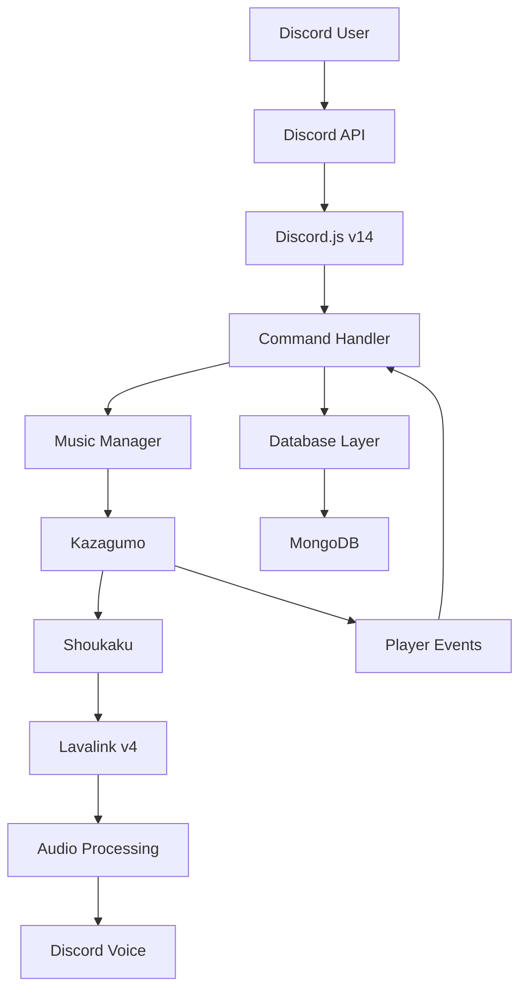
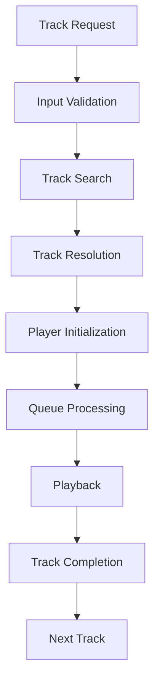
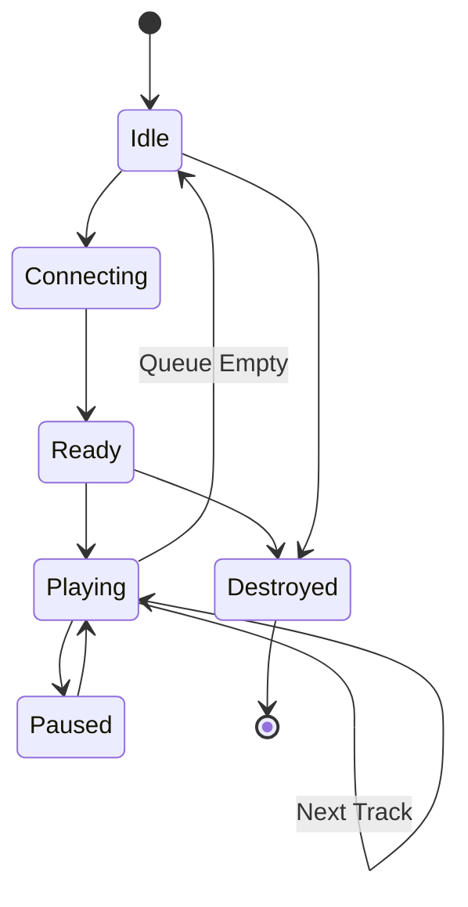

```html
<div align="center">


<br><br>


<br>


<br><br>

<a href="https://github.com/fraudelis/blaze/stargazers">

</a>
<a href="https://github.com/fraudelis/blaze/forks">

</a>
<a href="https://github.com/fraudelis/blaze/issues">

</a>
<a href="https://github.com/fraudelis/blaze/commits/main">

</a>
<a href="https://github.com/fraudelis/blaze/blob/main/LICENSE">

</a>

<br><br>


<br><br>

**[Repository](https://github.com/fraudelis/blaze)**
&nbsp; • &nbsp;
**[Issues](https://github.com/fraudelis/blaze/issues)**
&nbsp; • &nbsp;
**[Contributions](https://github.com/fraudelis/blaze/pulls)**

</div>

---

# Table of Contents

- [Introduction](#introduction)
- [Project Overview](#project-overview)
- [Core Infrastructure](#core-infrastructure)
- [Music Architecture](#music-architecture)
- [Playback Engine](#playback-engine)
- [Queue Management](#queue-management)
- [Interactive Controls](#interactive-controls)
- [Audio Processing](#audio-processing)
- [Personal Collections](#personal-collections)
- [Playlist Management](#playlist-management)
- [Database Infrastructure](#database-infrastructure)
- [Technology Stack](#technology-stack)
- [System Architecture](#system-architecture)
- [Processing Workflow](#processing-workflow)
- [Requirements](#requirements)
- [Installation](#installation)
- [Configuration](#configuration)
- [Environment Variables](#environment-variables)
- [Lavalink Configuration](#lavalink-configuration)
- [Database Setup](#database-setup)
- [Project Structure](#project-structure)
- [Command Architecture](#command-architecture)
- [Event Management](#event-management)
- [Player Lifecycle](#player-lifecycle)
- [Error Handling](#error-handling)
- [Performance](#performance)
- [Security](#security)
- [Development](#development)
- [Testing](#testing)
- [Deployment](#deployment)
- [Troubleshooting](#troubleshooting)
- [Contribution Guidelines](#contribution-guidelines)
- [License](#license)

---

# Introduction

A modern audio platform built around the Discord ecosystem, combining structured application architecture with dedicated audio-processing infrastructure.

The project uses Node.js and Discord.js v14 alongside Kazagumo, Shoukaku and Lavalink to manage music playback, player sessions, voice communication and audio processing.

The architecture is designed around independent components, maintainable code and extensible functionality.

Its primary focus is delivering a consistent playback experience while maintaining a clean foundation for future development.

<div align="center">


</div>

# Project Overview

| Property | Information |
|:---|:---|
| Project Category | Discord Application |
| Runtime | Node.js |
| Minimum Runtime | Node.js 20+ |
| Primary Language | JavaScript |
| Discord Library | Discord.js v14 |
| Music Manager | Kazagumo |
| Audio Manager | Shoukaku |
| Audio Server | Lavalink v4 |
| Database | MongoDB |
| Repository | fraudelis/blaze |
| License | MIT |

# Core Infrastructure

The application is organized around several independent systems.

### Application Layer

- Discord API communication.
- Command registration.
- Interaction handling.
- Permission validation.
- Guild configuration.

### Music Layer

- Track searching.
- Track loading.
- Player initialization.
- Queue processing.
- Playback management.

### Audio Layer

- Lavalink communication.
- Node management.
- Voice connectivity.
- Audio processing.
- Player synchronization.

### Storage Layer

- MongoDB connectivity.
- Persistent configuration.
- User preferences.
- Playlist records.
- Favourite collections.

---

# Music Architecture

The music infrastructure separates Discord interactions from the audio-processing environment.

Kazagumo manages music players, Shoukaku provides communication with Lavalink, and Lavalink handles the audio-processing workload.

<div align="center">


</div>

## System Architecture



## Architecture Responsibilities

| Component | Responsibility |
|:---|:---|
| Discord.js | Discord communication |
| Command Handler | Interaction processing |
| Kazagumo | Player management |
| Shoukaku | Lavalink communication |
| Lavalink | Audio processing |
| MongoDB | Persistent storage |
| Event Handler | Event processing |

---

# Playback Engine

The playback engine manages track requests and player sessions.

### Playback Capabilities

- Track searching.
- Track loading.
- Audio streaming.
- Automatic progression.
- Player initialization.
- Voice connection management.
- Playback state tracking.
- Track-end event processing.
- Lavalink node communication.

### Playback Workflow



---

# Queue Management

The queue system organizes upcoming tracks and maintains playback order.

### Queue Operations

| Operation | Description |
|:---|:---|
| Add | Add a track |
| Remove | Remove a selected track |
| Clear | Clear upcoming tracks |
| Shuffle | Randomize queue order |
| View | Display queued tracks |
| Skip | Move to the next track |
| Position | Manage track order |

Queue operations should validate the current player session before making modifications.

---

# Interactive Controls

The player-control system provides access to playback operations.

| Control | Function |
|:---|:---|
| Play | Start playback |
| Pause | Pause playback |
| Resume | Continue playback |
| Skip | Skip the current track |
| Stop | Stop the player |
| Volume | Change playback volume |
| Previous | Return to the previous track, if implemented |
| Filters | Apply supported audio effects |
| Queue | View upcoming tracks |

<div align="center">


</div>

---

# Audio Processing

Audio processing is handled through the configured Lavalink infrastructure.

### Supported Filter Concepts

| Filter | Purpose |
|:---|:---|
| Bass Boost | Low-frequency enhancement |
| Nightcore | Speed and pitch modification |
| Vaporwave | Slower playback effect |
| Karaoke | Vocal reduction |
| Tremolo | Volume modulation |
| Vibrato | Pitch modulation |
| Rotation | Stereo rotation |
| Equalizer | Frequency adjustment |
| Low-pass | Frequency filtering |
| Timescale | Playback speed adjustment |

Filter availability depends on the Lavalink version and installed plugins.

---

# Personal Collections

Personal music collections can be maintained through persistent user-specific records.

### Favourite Tracks

- Save favourite tracks.
- Retrieve saved tracks.
- Remove favourites.
- Maintain individual collections.
- Store track metadata.

### Playlist Management

- Create playlists.
- Rename playlists.
- Add tracks.
- Remove tracks.
- View saved playlists.
- Load saved collections.

---

# Database Infrastructure

MongoDB can provide persistent storage for application data.

### Suggested Collections

| Collection | Purpose |
|:---|:---|
| Guilds | Server configuration |
| Users | User preferences |
| Playlists | Personal playlists |
| Favourites | Saved tracks |
| Settings | Application settings |

Database operations should use validated schemas and appropriate error handling.

---

# Technology Stack

<div align="center">


</div>

| Technology | Usage |
|:---|:---|
| Node.js | Application runtime |
| JavaScript | Main programming language |
| Discord.js | Discord integration |
| Kazagumo | Music management |
| Shoukaku | Audio communication |
| Lavalink | Audio processing |
| MongoDB | Database |
| Git | Version control |
| GitHub | Source management |

---

# Requirements

Before installing, ensure the following dependencies are available.

- Node.js 20 or newer.
- npm package manager.
- Discord application.
- Discord bot token.
- Lavalink v4 server.
- MongoDB connection, if database features are enabled.

---

# Installation

### 01. Clone the repository

```bash
git clone https://github.com/fraudelis/blaze.git
```

### 02. Enter the directory

```bash
cd blaze
```

### 03. Install dependencies

```bash
npm install
```

### 04. Configure environment variables

Create a `.env` file in the project root.

```env
TOKEN=YOUR_DISCORD_BOT_TOKEN
CLIENT_ID=YOUR_DISCORD_APPLICATION_ID

MONGO_URI=YOUR_MONGODB_URI

LAVALINK_HOST=localhost
LAVALINK_PORT=2333
LAVALINK_PASSWORD=YOUR_LAVALINK_PASSWORD
```

### 05. Start the application

```bash
npm start
```

If the project does not have a start script:

```bash
node index.js
```

Use the actual entry-point filename configured in your project.

---

# Configuration

Configuration should be maintained separately from application logic.

Recommended configuration categories:

- Discord credentials.
- Lavalink connection.
- Database connection.
- Application settings.
- Logging configuration.
- Command settings.

Never commit private credentials to a public repository.

---

# Environment Variables

| Variable | Description |
|:---|:---|
| TOKEN | Discord bot token |
| CLIENT_ID | Discord application ID |
| MONGO_URI | MongoDB connection URI |
| LAVALINK_HOST | Lavalink hostname |
| LAVALINK_PORT | Lavalink server port |
| LAVALINK_PASSWORD | Lavalink authentication password |

These are example variable names. Match them to the actual implementation.

---

# Lavalink Configuration

Example `application.yml`:

```yaml
server:
  port: 2333
  address: 0.0.0.0

lavalink:
  server:
    password: "YOUR_SECURE_PASSWORD"
    sources:
      youtube: false
      bandcamp: true
      soundcloud: true
      twitch: true
      vimeo: true
      http: true
      local: false
```

Configure the appropriate audio sources and plugins for your deployment.

---

# Project Structure

A suggested modular organization:

```text
blaze/
│
├── src/
│   ├── commands/
│   │   ├── music/
│   │   └── utility/
│   │
│   ├── events/
│   │   ├── client/
│   │   ├── music/
│   │   └── player/
│   │
│   ├── handlers/
│   │
│   ├── database/
│   │
│   ├── music/
│   │
│   ├── structures/
│   │
│   └── utils/
│
├── config/
│
├── models/
│
├── .env.example
├── .gitignore
├── package.json
├── package-lock.json
└── index.js
```

The actual directory structure may differ depending on the implementation.

---

# Command Architecture

The command handler should provide a consistent interaction-processing workflow.

Recommended responsibilities:

- Command registration.
- Input validation.
- Permission verification.
- Voice-channel validation.
- Player availability checks.
- Error responses.
- Command execution.

# Event Management

Event handlers should process Discord and music-related events independently.

Examples include:

- Client ready.
- Interaction creation.
- Track start.
- Track end.
- Track exception.
- Player creation.
- Player destruction.
- Lavalink node connection.
- Lavalink node disconnection.

# Player Lifecycle



# Error Handling

Reliable error handling is essential for maintaining application stability.

Recommended practices:

- Validate incoming interactions.
- Handle unavailable tracks.
- Monitor Lavalink connectivity.
- Handle voice connection interruptions.
- Catch asynchronous errors.
- Log unexpected exceptions.
- Avoid exposing private credentials.
- Provide useful error messages.

# Performance

Performance considerations include:

- Efficient asynchronous execution.
- Reusable utility functions.
- Controlled database queries.
- Proper player cleanup.
- Connection monitoring.
- Optimized event listeners.
- Resource-aware deployment.

# Security

Security practices should include:

- Environment-based credentials.
- Restricted configuration access.
- Permission validation.
- Input validation.
- Secure database connections.
- Protected deployment secrets.
- Regular dependency updates.

---

# Development

### Local Development

```bash
npm install
npm start
```

### Dependency Updates

```bash
npm outdated
```

### Dependency Installation

```bash
npm install
```

### Git Status

```bash
git status
```

### Commit Changes

```bash
git add .
git commit -m "Update application"
```

# Testing

Before deploying changes, verify:

- Application startup.
- Discord authentication.
- Command registration.
- Lavalink connectivity.
- Player initialization.
- Queue processing.
- Playback controls.
- Database connectivity.
- Error handling.

# Deployment

The application can be deployed on a compatible Node.js hosting environment.

Deployment checklist:

- Configure the Node.js runtime.
- Install project dependencies.
- Set environment variables.
- Configure Lavalink connectivity.
- Configure MongoDB access.
- Start the application.
- Monitor application logs.
- Verify Discord connectivity.

---

# Troubleshooting

| Issue | Recommended Check |
|:---|:---|
| Application crashes | Review startup logs |
| Invalid token | Verify bot credentials |
| Lavalink connection fails | Check host and port |
| Authentication fails | Verify Lavalink password |
| No search results | Check configured sources |
| Database unavailable | Verify MongoDB URI |
| Voice connection fails | Check voice permissions |
| Playback stops | Review player events |
| Commands unavailable | Verify command registration |

---

# Contribution Guidelines

Contributions are welcome.

1. Fork the repository.
2. Create a development branch.
3. Make your changes.
4. Test your implementation.
5. Commit your changes.
6. Submit a pull request.

Please maintain consistent formatting, readable code and proper error handling.

# License

This project is distributed under the MIT License.

Refer to the `LICENSE` file for complete licensing information.

---

<div align="center">


<br><br>


<br><br>

<a href="https://github.com/fraudelis/blaze">

</a>

<br><br>


<br><br>

**Designed for reliability. Built for extensibility.**

<sub>© 2026 — Open-source development.</sub>

</div>
```

---

**Before publishing:**
- Replace the example project structure with your actual folders.
- Confirm the listed features are implemented before advertising them as available.
- Keep the external image and animation links if you want them displayed on GitHub.
- The GitHub statistics badges automatically use your repository data.
