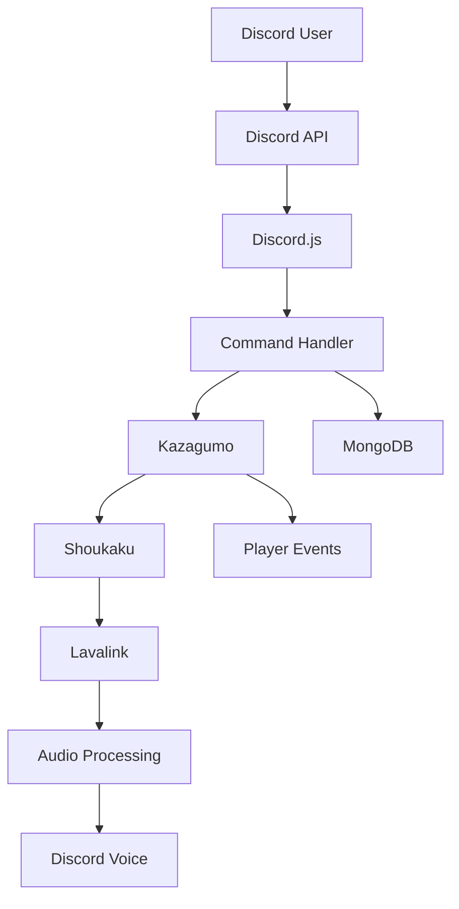
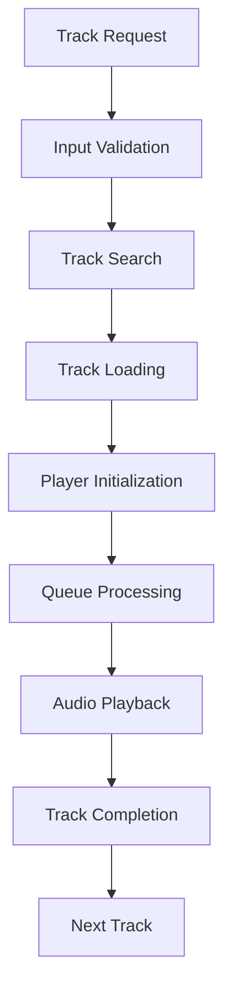
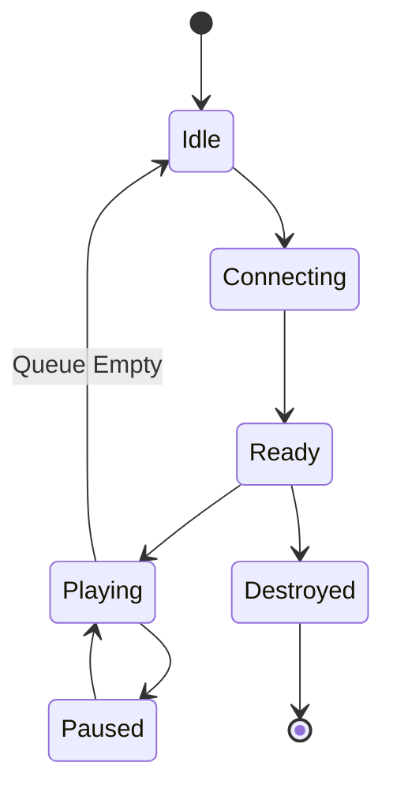

 <div align="center">


<br>


<br><br>


<br><br>

<a href="https://github.com/fraudelis/blaze/stargazers"></a>
<a href="https://github.com/fraudelis/blaze/forks"></a>
<a href="https://github.com/fraudelis/blaze/issues"></a>
<a href="https://github.com/fraudelis/blaze/commits/main"></a>
<a href="https://github.com/fraudelis/blaze/blob/main/LICENSE"></a>

<br><br>


<br>

**[Repository](https://github.com/fraudelis/blaze) · [Issues](https://github.com/fraudelis/blaze/issues) · [Pull Requests](https://github.com/fraudelis/blaze/pulls)**

</div>

---

# Overview

A modular Discord application built using modern JavaScript technologies and a dedicated audio-processing infrastructure.

The project integrates Discord.js, Kazagumo, Shoukaku and Lavalink to manage music playback, player sessions, voice communication and audio processing.

Its architecture focuses on modularity, reliability, maintainability and extensibility.

<div align="center">

</div>

## Project Information

| Property | Details |
|:---|:---|
| Runtime | Node.js 20+ |
| Language | JavaScript |
| Discord Library | Discord.js v14 |
| Music Manager | Kazagumo |
| Audio Manager | Shoukaku |
| Audio Server | Lavalink v4 |
| Database | MongoDB |
| Repository | fraudelis/blaze |
| License | MIT |

---

# Core Systems

### Music Playback
- Track searching and loading.
- Lavalink audio streaming.
- Automatic track progression.
- Voice connection management.
- Player initialization.
- Playback state management.

### Queue Management
- Add and remove tracks.
- Shuffle playback order.
- Clear upcoming tracks.
- Display queue information.
- Automatic next-track handling.

### Interactive Controls
- Play and pause.
- Resume playback.
- Skip and stop.
- Volume adjustment.
- Previous track support, if implemented.
- Audio filter management.

### Personal Collections
- Favourite tracks.
- Personal playlists.
- Saved music collections.
- Persistent user preferences.

---

# Technology Stack

<div align="center">


</div>

| Technology | Purpose |
|:---|:---|
| Node.js | Runtime |
| JavaScript | Development |
| Discord.js | Discord API |
| Kazagumo | Music management |
| Shoukaku | Lavalink communication |
| Lavalink | Audio processing |
| MongoDB | Persistent storage |

---

# System Architecture



# Playback Workflow



---

# Audio Filters

| Filter | Function |
|:---|:---|
| Bass Boost | Enhance low frequencies |
| Nightcore | Modify speed and pitch |
| Vaporwave | Slower playback effect |
| Karaoke | Vocal reduction |
| Tremolo | Volume modulation |
| Vibrato | Pitch modulation |
| Rotation | Stereo rotation |
| Equalizer | Frequency adjustment |
| Low-pass | Frequency filtering |
| Timescale | Playback speed |

*Filter availability depends on Lavalink plugins and configuration.*

---

# Installation

### Requirements

- Node.js 20+
- npm
- Discord application
- Lavalink v4
- MongoDB, if required

### Clone Repository

```bash
git clone https://github.com/fraudelis/blaze.git
cd blaze
```

### Install Dependencies

```bash
npm install
```

### Configure Environment

Create a `.env` file:

```env
TOKEN=YOUR_DISCORD_BOT_TOKEN
CLIENT_ID=YOUR_DISCORD_APPLICATION_ID

MONGO_URI=YOUR_MONGODB_URI

LAVALINK_HOST=localhost
LAVALINK_PORT=2333
LAVALINK_PASSWORD=YOUR_LAVALINK_PASSWORD
```

### Start Application

```bash
npm start
```

If no start script exists:

```bash
node index.js
```

---

# Lavalink Configuration

Example `application.yml`:

```yaml
server:
  port: 2333

lavalink:
  server:
    password: "YOUR_SECURE_PASSWORD"
    sources:
      youtube: false
      bandcamp: true
      soundcloud: true
      twitch: true
      vimeo: true
      http: true
      local: false
```

---

# Project Structure

```text
blaze/
│
├── src/
│   ├── commands/
│   │   ├── music/
│   │   └── utility/
│   │
│   ├── events/
│   │   ├── client/
│   │   └── music/
│   │
│   ├── handlers/
│   ├── database/
│   ├── music/
│   ├── structures/
│   └── utils/
│
├── config/
├── models/
├── .env.example
├── .gitignore
├── package.json
└── index.js
```

*Adjust this structure to match the actual repository.*

---

# Player Lifecycle



---

# Development Standards

| Principle | Description |
|:---|:---|
| Modularity | Independent application components |
| Reliability | Connection and error handling |
| Performance | Efficient asynchronous operations |
| Maintainability | Consistent code structure |
| Security | Protected credentials |
| Scalability | Extensible architecture |

# Security

- Store credentials in environment variables.
- Never publish private tokens.
- Validate user permissions.
- Protect database credentials.
- Validate incoming interactions.
- Keep dependencies updated.

# Troubleshooting

| Problem | Solution |
|:---|:---|
| Invalid token | Verify Discord credentials |
| Lavalink unavailable | Check host and port |
| Authentication failed | Verify Lavalink password |
| No search results | Check configured sources |
| Database error | Verify MongoDB URI |
| Voice connection failed | Check bot permissions |
| Startup error | Review application logs |

# Contribution Guidelines

1. Fork the repository.
2. Create a development branch.
3. Implement your changes.
4. Test your implementation.
5. Commit your changes.
6. Submit a pull request.

# License

Distributed under the MIT License. See the `LICENSE` file for details.

---

<div align="center">


<br><br>


<br><br>

<a href="https://github.com/fraudelis/blaze">

</a>

<br><br>


</div>
